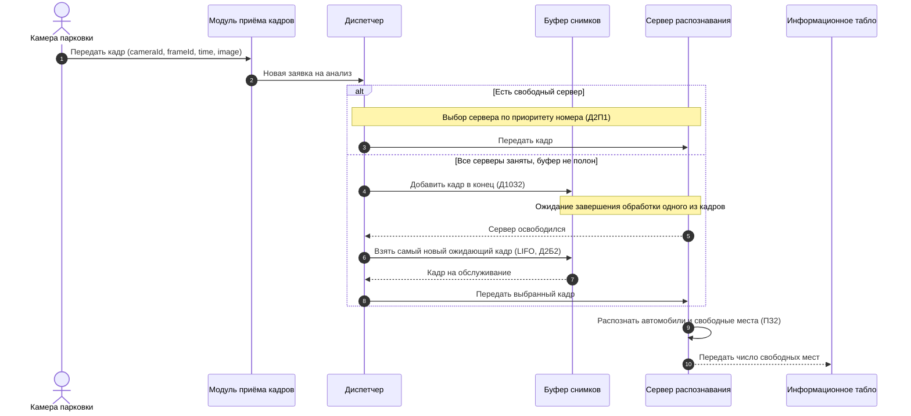

# Диаграмма последовательности № 1: приём и обработка кадра

Показывает обычный сценарий с обработкой без очереди и с ожиданием в буфере. Здесь выбор сервера зависит от приоритета номера (Д2П1), а выбор ожидающего снимка — от LIFO (Д2Б2).

**Связь с бизнес-доменом:** источником выступает камера; заявка — снимок; прибор — сервер распознавания; выход — сведения для табло. Время анализа имеет равномерное распределение (ПЗ2) в имитационной модели.
