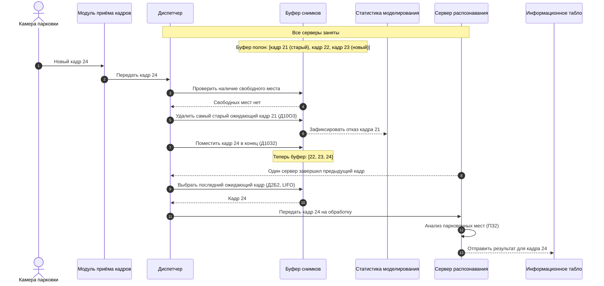

# Диаграмма последовательности № 2: переполнение буфера и отказ

Сценарий иллюстрирует важное правило варианта № 7: при занятости всех серверов и заполнении буфера **отказ получает не новый кадр, а самый старый ожидающий кадр** (Д10О3).

**Важно:** уже обслуживаемые сервером кадры не удаляются. Удаление касается только очереди ожидания. Номера 21–24 — условные идентификаторы для иллюстрации, а не фактические параметры системы.
