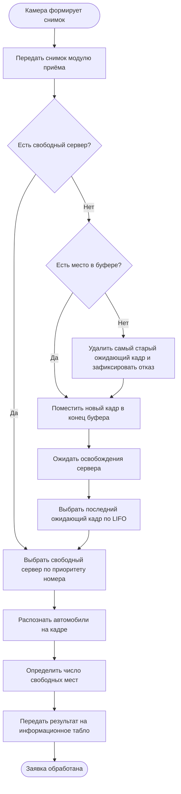

# Диаграмма бизнес-процесса: путь снимка парковки

Это схема процесса на основе бизнес-домена. Она объединяет нормальный путь, ожидание и переполнение. На диаграмме отражены правила постановки в очередь, отказа и последующего выбора заявки.

**Важное ограничение:** конкретные размеры буфера, количество серверов и длительность обслуживания определяются параметрами имитационной модели, но в этих артефактах не задаются произвольно.
