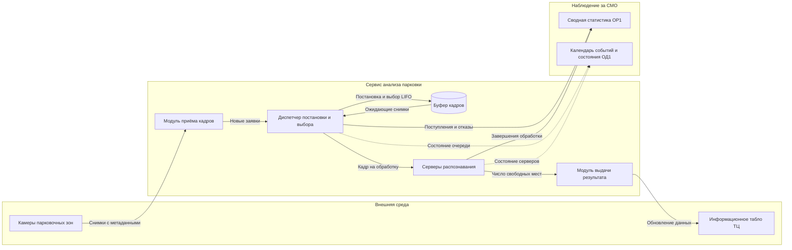

# Диаграмма компонентов: система распознавания парковочных мест

Показаны логические элементы бизнес-домена и элементы модели СМО. Это **не утверждение о реализованных микросервисах**, а схема предполагаемой системы.

**Примечание:** у сервера распознавания может быть более одного экземпляра («приборов» СМО). Правила выбора экземпляра задаёт Д2П1.
